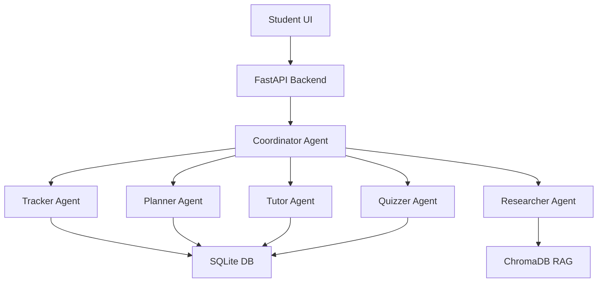

# StudyCrew - Multi-Agent Study Planner

A web app powered by a multi-agent AI system that creates personalized study plans, generates notes, explains topics, creates quizzes, and tracks mastery.

## Architecture



## Tech Stack

- **Backend**: Python 3.11+, FastAPI, SQLAlchemy, CrewAI, Ollama
- **Frontend**: React 18, Vite, TypeScript, Tailwind CSS, Recharts
- **Database**: SQLite (dev), PostgreSQL (prod ready)
- **Vector DB**: ChromaDB with sentence-transformers embeddings
- **LLM**: Ollama (llama3.1:8b by default)

## Quick Start

### Prerequisites

- Python 3.11+
- Node.js 18+
- Ollama running locally (`ollama serve`)
- Model pulled: `ollama pull llama3.1:8b`

### Backend Setup

```bash
cd studycrew/backend

# Create virtual environment
python -m venv .venv
source .venv/bin/activate  # Windows: .venv\Scripts\activate

# Install dependencies
pip install -r requirements.txt

# Copy env file and configure
cp ../.env.example .env
# Edit .env with your settings

# Run database migrations
alembic upgrade head

# Start server
uvicorn app.main:app --reload --port 8000
```

### Frontend Setup

```bash
cd studycrew/frontend

# Install dependencies
npm install

# Start dev server
npm run dev
```

### Access the App

- Frontend: http://localhost:5173
- Backend API: http://localhost:8000
- API Docs: http://localhost:8000/docs

## Project Structure

```
studycrew/
├── .env.example
├── README.md
├── backend/
│   ├── requirements.txt
│   ├── pyproject.toml
│   ├── alembic/
│   └── app/
│       ├── main.py
│       ├── config.py
│       ├── llm.py
│       ├── schemas.py
│       ├── db.py
│       ├── rag.py
│       ├── agents/
│       │   ├── base.py
│       │   ├── coordinator.py
│       │   ├── planner.py
│       │   ├── researcher.py
│       │   ├── tutor.py
│       │   ├── quizzer.py
│       │   └── tracker.py
│       ├── prompts/
│       │   ├── coordinator.py
│       │   ├── planner.py
│       │   ├── researcher.py
│       │   ├── tutor.py
│       │   └── quizzer.py
│       ├── api/
│       │   ├── courses.py
│       │   ├── uploads.py
│       │   ├── runs.py
│       │   ├── topics.py
│       │   ├── quizzes.py
│       │   └── progress.py
│       └── tests/
└── frontend/
    ├── package.json
    ├── vite.config.ts
    ├── tailwind.config.js
    ├── tsconfig.json
    ├── index.html
    └── src/
        ├── main.tsx
        ├── App.tsx
        ├── index.css
        ├── lib/
        │   ├── api.ts
        │   └── utils.ts
        ├── hooks/
        │   └── useSSE.ts
        ├── pages/
        │   ├── CourseSetup.tsx
        │   ├── PlanView.tsx
        │   ├── TopicView.tsx
        │   └── Dashboard.tsx
        └── components/
            └── LiveAgentFeed.tsx
```

## API Endpoints

| Method | Endpoint | Description |
|--------|----------|-------------|
| POST | `/api/courses` | Create course with topics |
| GET | `/api/courses` | List all courses |
| GET | `/api/courses/{id}` | Get course with topics |
| POST | `/api/courses/{id}/upload` | Upload study materials |
| GET | `/api/courses/{id}/uploads` | List uploads |
| POST | `/api/runs` | Create new crew run |
| GET | `/api/runs/{id}/events` | SSE stream for agent events |
| POST | `/api/runs/{id}/execute` | Execute crew |
| GET | `/api/courses/{id}/plan` | Get latest study plan |
| POST | `/api/courses/{id}/replan` | Regenerate plan with updated mastery |
| GET | `/api/courses/{id}/progress` | Get progress dashboard |
| GET | `/api/topics/{id}/content` | Get notes & explanation |
| POST | `/api/topics/{id}/ask` | Ask follow-up question |
| POST | `/api/quizzes/generate` | Generate quiz |
| POST | `/api/quizzes/{attempt_id}/submit` | Submit quiz answers |

## Agent Workflows

### 1. Initial Plan (`POST /api/runs` → `POST /api/runs/{id}/execute`)

1. **Planner**: Creates day-by-day study plan based on topics, exam date, hours/day, mastery
2. **Researcher** (parallel per topic): Retrieves relevant chunks from uploaded docs + LLM knowledge → condensed notes
3. **Tutor** (parallel per topic): Explains topic at student's level with analogies, examples, common mistakes

### 2. Quiz Generation (`POST /api/quizzes/generate`)

- **Quizzer**: Generates 5 MCQs adapted to mastery level (low mastery = easier)

### 3. Quiz Submission (`POST /api/quizzes/{attempt_id}/submit`)

- **Python Grading**: Compares answers to correct_index (no LLM)
- **Tracker**: Updates mastery: `new = 0.7 * old + 0.3 * score`

### 4. Re-plan (`POST /api/courses/{id}/replan`)

- Gets updated masteries from Tracker
- Runs Planner again for remaining days
- Weak topics get more time

## Configuration

Key environment variables (`.env`):

```bash
# Ollama
OLLAMA_BASE_URL=http://localhost:11434
LLM_MODEL=llama3.1:8b
LLM_TEMPERATURE=0.1
LLM_NUM_CTX=8192

# Embeddings
EMBEDDING_MODEL=sentence-transformers/all-MiniLM-L6-v2

# Database
DATABASE_URL=sqlite:///./studycrew.db

# ChromaDB
CHROMA_PATH=./chroma_data

# RAG
CHUNK_SIZE=500
CHUNK_OVERLAP=50

# Ports
BACKEND_PORT=8000
FRONTEND_ORIGIN=http://localhost:5173
```

## Development

### Running Tests

```bash
cd studycrew/backend
pytest -v
```

### Linting & Formatting

```bash
# Backend
cd studycrew/backend
ruff check .
ruff format .
black .

# Frontend
cd studycrew/frontend
npm run lint
npm run format
```

### Pre-commit Hooks

```bash
cd studycrew/backend
pre-commit install
```

## Demo Data

To seed a demo course (DBMS, 10 days, 8 topics):

```bash
cd studycrew/backend
python -m app.seed
```

Then open http://localhost:5173 and select the demo course.

## Deployment

### Docker (Optional)

```dockerfile
# Dockerfile.backend
FROM python:3.11-slim
WORKDIR /app
COPY backend/requirements.txt .
RUN pip install -r requirements.txt
COPY backend/app ./app
CMD ["uvicorn", "app.main:app", "--host", "0.0.0.0", "--port", "8000"]
```

### Production Checklist

- [ ] Use PostgreSQL instead of SQLite
- [ ] Set up Redis for SSE event queues
- [ ] Configure proper CORS origins
- [ ] Add authentication (JWT/OAuth)
- [ ] Set up monitoring (Sentry, Prometheus)
- [ ] Use a managed vector DB (Pinecone, Weaviate) or scale ChromaDB
- [ ] Configure Ollama with GPU support

## Contributing

1. Fork the repo
2. Create a feature branch
3. Make changes with tests
4. Run linting and tests
5. Submit a PR

## License

MIT License - feel free to use for your own projects!