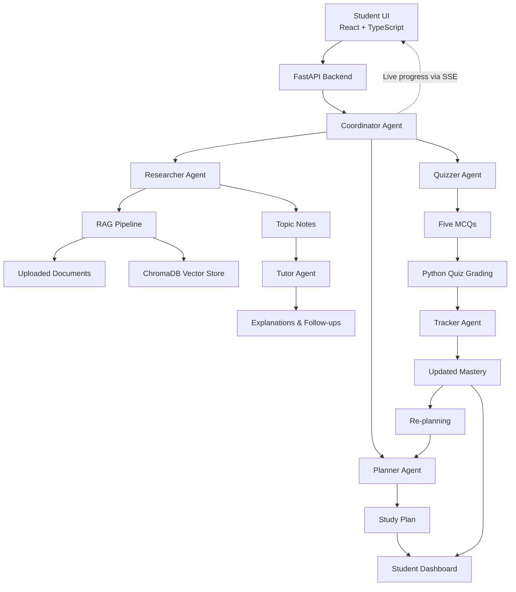
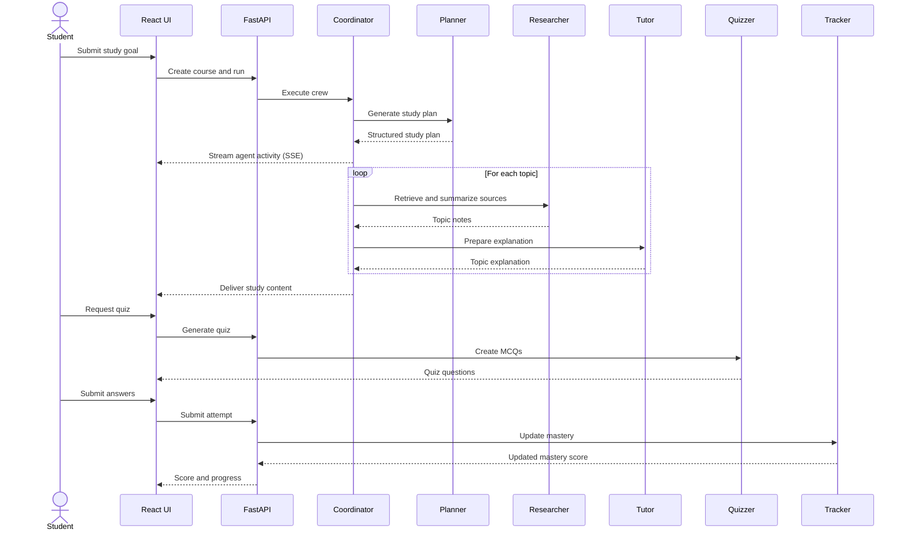

# 📚 StudyCrew — Your AI-Powered Study Team

<p align="center">
  
  
  
  
  
</p>

<p align="center">
  <strong>One goal. Six AI agents. A smarter way to study.</strong>
  <br/>
  Turn your syllabus into a personalized study plan with AI-generated notes, an interactive tutor, adaptive quizzes, and mastery tracking.
</p>

<p align="center">
  <em>Plan smarter · Learn deeper · Test yourself · Improve continuously</em>
</p>

---

## 📖 Table of Contents

- [Overview](#-overview)
- [Why StudyCrew?](#-why-studycrew)
- [Key Features](#-key-features)
- [How It Works](#-how-it-works)
- [Architecture](#-architecture)
- [Screenshots](#-screenshots)
- [Tech Stack](#-tech-stack)
- [Getting Started](#-getting-started)
- [Configuration](#-configuration)
- [API Reference](#-api-reference)
- [Project Structure](#-project-structure)
- [Development](#-development)
- [Deployment](#-deployment)
- [Contributing](#-contributing)
- [License](#-license)
- [Acknowledgments](#-acknowledgments)

---

## 🚀 Overview

**StudyCrew** is a multi-agent AI study planner that transforms a student's learning goal into an actionable, personalized study experience. Instead of relying on a single AI assistant, StudyCrew coordinates six specialized agents—Planner, Researcher, Tutor, Quizzer, Tracker, and Coordinator—to organize study sessions, generate contextual learning materials, explain difficult concepts, assess understanding, and adapt future study plans based on performance.

Students can provide their subject, exam date, available study hours, learning level, syllabus, and reference documents. StudyCrew then builds a day-by-day plan, prepares topic-specific notes using Retrieval-Augmented Generation (RAG), provides conversational tutoring, generates adaptive multiple-choice quizzes, and tracks topic mastery over time.

Powered by **CrewAI, FastAPI, React, Ollama, and ChromaDB**, StudyCrew is designed around modular AI agents, locally runnable language models, and a learning workflow that continuously improves as students practice.

> **Our vision:** Make personalized, AI-assisted learning more organized, interactive, and accessible to every student.

## 💡 Why StudyCrew?

Traditional study planning often stops at creating a timetable. StudyCrew connects planning, learning, assessment, and progress tracking into one continuous workflow.

| Traditional approach | StudyCrew |
|---|---|
| Manually create study timetables | Generate personalized daily study plans |
| Search for notes across multiple sources | Retrieve and summarize relevant learning material |
| Struggle with difficult concepts | Ask an AI tutor for level-appropriate explanations |
| Take generic practice tests | Generate topic-focused quizzes |
| Track progress manually | Update mastery scores using quiz performance |
| Repeat the same study schedule | Re-plan around weaker topics |

## ✨ Key Features

### 🤖 Six Specialized AI Agents

- **🗓️ Planner:** Creates a day-by-day study schedule based on exam deadlines, topic priorities, available hours, and mastery levels.
- **🔎 Researcher:** Retrieves relevant content from uploaded documents and available LLM knowledge, producing condensed notes with citations where supported by source material.
- **🎓 Tutor:** Explains concepts at beginner, intermediate, or advanced levels using analogies, examples, common mistakes, and conversational follow-up answers.
- **🧠 Quizzer:** Generates five-question MCQ quizzes with four options per question and difficulty informed by topic mastery.
- **📈 Tracker:** Updates topic mastery using quiz performance and the weighted mastery formula.
- **⚙️ Coordinator:** Orchestrates the agents, manages execution flow, and streams live agent activity to the frontend through Server-Sent Events (SSE).

### 📚 Personalized Study Planning

- Create plans from a subject, exam date, syllabus, and daily study availability.
- Prioritize important topics and allocate study time.
- Regenerate plans when mastery scores change.
- Track remaining preparation days.

### 📄 Document-Based Learning with RAG

- Upload PDF, TXT, and Markdown documents.
- Split documents into manageable text chunks.
- Generate embeddings using Sentence Transformers.
- Store and retrieve relevant content using ChromaDB.
- Produce topic-specific notes grounded in retrieved documents, with source citations where available.

### 💬 Interactive AI Tutoring

- Choose a preferred learning level.
- Understand difficult topics through analogies and practical examples.
- Identify common misconceptions and mistakes.
- Ask follow-up questions without restarting the learning workflow.

### 📝 Adaptive Quizzes

- Generate five MCQs per quiz.
- Receive a score and answer explanations.
- Adjust question difficulty based on topic mastery.
- Use quiz performance to inform future study plans.

### 📊 Progress Dashboard

- View topic-wise mastery bars.
- Review quiz history and scores.
- Track the number of days remaining before an exam.
- Identify weaker topics that need additional attention.

### ⚡ Real-Time Agent Activity

Follow the AI crew while it works. The live activity feed displays agent execution events, including `started`, `done`, and `error`, using SSE.

### 🔒 Local AI Support

Run the language model and embedding pipeline locally for greater control over your learning data. Local execution requirements depend on your hardware and model configuration.

---

## 🔄 How It Works

1. **Define your goal:** Enter your subject, exam date, available hours, learning level, and syllabus.
2. **Upload study material:** Optionally provide PDF, TXT, or Markdown reference documents.
3. **Build your crew plan:** The Coordinator orchestrates the agents and streams live progress.
4. **Study each topic:** Explore condensed notes, detailed explanations, and follow-up questions.
5. **Test your knowledge:** Take a five-question quiz and review the results.
6. **Track mastery:** Update your topic mastery score using quiz performance.
7. **Re-plan intelligently:** Generate an updated schedule that accounts for weaker topics and remaining preparation time.

### Mastery Update Formula

StudyCrew uses a weighted update to balance previous mastery with new quiz performance:

\[
M_{\text{new}} = 0.7M_{\text{old}} + 0.3Q
\]

Where:

- \(M_{\text{old}}\) = previous mastery score
- \(Q\) = latest quiz score
- \(M_{\text{new}}\) = updated mastery score

**Example:** If previous mastery is 60% and the latest quiz score is 80%, the updated mastery becomes 66%.

This approach allows new quiz results to influence progress without completely discarding previous performance.

---

## 🏗️ Architecture

StudyCrew separates the user interface, API layer, agent orchestration, learning workflows, and data storage.

### System Architecture



### Agent Execution Flow



---

## 🖥️ Screenshots

Add screenshots of your actual application to showcase the complete learning experience.

| Screen | Suggested screenshot |
|---|---|
| Course Setup | Subject, exam date, daily hours, learning level, syllabus, and file uploads |
| Live Agent Feed | Coordinator activity and individual agent status |
| Study Plan | Day-by-day schedule and topic priorities |
| Topic Learning | Condensed notes, explanations, and tutor chat |
| Quiz Interface | MCQs, answer selection, and submission |
| Progress Dashboard | Mastery bars, quiz history, and days remaining |

Once you add screenshots, you can display them like this:

```markdown

```

Suggested directory:

```text
docs/
└── screenshots/
    ├── course-setup.png
    ├── agent-feed.png
    ├── study-plan.png
    ├── topic-learning.png
    ├── quiz.png
    └── dashboard.png
```

*Screenshots are placeholders until actual application captures are added.*

---

## 🛠️ Tech Stack

| Layer | Technologies | Purpose |
|---|---|---|
| Frontend | React 18, TypeScript, Vite | Interactive web interface |
| Styling | Tailwind CSS | Responsive UI styling |
| Charts | Recharts | Mastery and progress visualization |
| Content rendering | React Markdown | Render formatted study notes |
| Icons | Lucide | Consistent interface icons |
| Backend | Python 3.11+, FastAPI, Uvicorn | API and application server |
| Agent orchestration | CrewAI | Coordinate specialized AI agents |
| Language model | Ollama, Llama 3.1 8B | Local language-model inference |
| Validation | Pydantic v2 | Validate structured model outputs |
| Embeddings | Sentence Transformers, `all-MiniLM-L6-v2` | Convert text into embedding vectors |
| Vector database | ChromaDB | Persistent semantic retrieval |
| RAG processing | `pypdf`, custom chunking pipeline | Extract and retrieve document content |
| Database | SQLite, SQLAlchemy async | Development persistence |
| Migrations | Alembic | Database schema management |
| Production database | PostgreSQL-ready | Production persistence |
| Real-time updates | Server-Sent Events | Stream agent execution events |
| Testing | pytest | Backend test automation |
| Code quality | Ruff, Black, MyPy | Linting, formatting, and type checking |
| Frontend quality | ESLint, Prettier | Frontend linting and formatting |
| Automation | pre-commit, GitHub Actions | Local hooks and CI checks |

---

## 🚀 Getting Started

Follow these instructions to run StudyCrew locally.

### Prerequisites

Install the following tools before starting:

- [Python 3.11 or later](https://www.python.org/downloads/)
- [Node.js 18 or later](https://nodejs.org/)
- [Git](https://git-scm.com/downloads)
- [Ollama](https://ollama.com/download)

Check your installations:

```bash
python --version
node --version
npm --version
git --version
ollama --version
```

### 1. Clone the Repository

```bash
git clone <YOUR_REPOSITORY_URL>
cd studycrew
```

Replace `<YOUR_REPOSITORY_URL>` with your actual GitHub repository URL.

### 2. Set Up Ollama

Start the Ollama service using the appropriate command for your operating system.

```bash
ollama serve
```

In a separate terminal, download the language model:

```bash
ollama pull llama3.1:8b
```

Verify that the model is available:

```bash
ollama list
```

Ensure Ollama is running and accessible at `http://localhost:11434` before using the application.

> **Note:** The Llama 3.1 8B model requires sufficient memory and compute resources. Performance depends on your hardware, quantization, context length, and concurrent workload.

### 3. Set Up the Backend

Open a terminal in the repository root:

```bash
cd backend
```

Create a virtual environment:

```bash
python -m venv .venv
```

Activate it.

**Windows — PowerShell:**

```powershell
.\.venv\Scripts\Activate.ps1
```

**Windows — Command Prompt:**

```bat
.venv\Scripts\activate.bat
```

**macOS / Linux:**

```bash
source .venv/bin/activate
```

Install Python dependencies:

```bash
python -m pip install --upgrade pip
pip install -r requirements.txt
```

Configure your environment variables as described in the [Configuration](#-configuration) section.

Run database migrations:

```bash
alembic upgrade head
```

Start the development server:

```bash
uvicorn app.main:app --reload --port 8000
```

The API should now be available at `http://localhost:8000`.

Interactive API documentation is available at:

- Swagger UI: `http://localhost:8000/docs`
- ReDoc: `http://localhost:8000/redoc`

### 4. Set Up the Frontend

Open a second terminal from the repository root:

```bash
cd frontend
npm install
npm run dev
```

Open the frontend in your browser:

**http://localhost:5173**

Keep the backend, frontend, and Ollama service running while using the application.

### 5. Seed Demo Data (Optional)

If the project includes the provided seed script and its dependencies are installed, open another terminal:

```bash
cd backend
```

Activate the backend virtual environment if necessary, then run:

```bash
python -m app.seed
```

The seed script can be used to populate demo data for development. Check its implementation for the exact records it creates.

### Quick Start Checklist

- [ ] Python dependencies installed
- [ ] Node.js dependencies installed
- [ ] Ollama service running
- [ ] `llama3.1:8b` downloaded
- [ ] Environment variables configured
- [ ] Database migrations applied
- [ ] Backend running on port `8000`
- [ ] Frontend running on port `5173`

---

## ⚙️ Configuration

Create an environment file based on the following template.

**Recommended location:** `backend/.env`

```dotenv
# Ollama / LLM
OLLAMA_BASE_URL=http://localhost:11434
LLM_MODEL=llama3.1:8b
LLM_TEMPERATURE=0.2
LLM_NUM_CTX=8192

# Embeddings
EMBEDDING_MODEL=sentence-transformers/all-MiniLM-L6-v2

# Database
DATABASE_URL=sqlite+aiosqlite:///./studycrew.db

# ChromaDB
CHROMA_PATH=./chroma_db

# RAG chunking
CHUNK_SIZE=500
CHUNK_OVERLAP=50

# Application
BACKEND_PORT=8000
FRONTEND_ORIGIN=http://localhost:5173
```

### Environment Variable Reference

| Variable | Description |
|---|---|
| `OLLAMA_BASE_URL` | Base URL of the Ollama service |
| `LLM_MODEL` | Ollama model name |
| `LLM_TEMPERATURE` | Controls response variability |
| `LLM_NUM_CTX` | Configured model context length |
| `EMBEDDING_MODEL` | Sentence Transformers embedding model |
| `DATABASE_URL` | SQLAlchemy-compatible database connection URL |
| `CHROMA_PATH` | Local persistent ChromaDB directory |
| `CHUNK_SIZE` | Target document chunk size |
| `CHUNK_OVERLAP` | Overlap between adjacent chunks |
| `BACKEND_PORT` | Backend port configuration |
| `FRONTEND_ORIGIN` | Allowed frontend origin for cross-origin requests |

**Important:**

- These are example values; ensure they match the application's actual configuration names and defaults.
- Confirm that the backend reads `backend/.env` and that the selected database driver is installed.
- The SQLite URL above assumes `aiosqlite` is installed and supported by the project.
- Keep secrets and private configuration out of Git. Add `.env` files to `.gitignore`.
- The embedding model may need to be downloaded on first use.
- For production, use a secure database connection, persistent storage, appropriate CORS restrictions, and protected API access.

---

## 🔌 API Reference

The following endpoints describe the intended StudyCrew API surface.

Base URL for local development: `http://localhost:8000`

| Method | Endpoint | Description |
|---|---|---|
| `POST` | `/api/courses` | Create a course and its topics |
| `POST` | `/api/courses/{id}/upload` | Upload documents, chunk text, generate embeddings, and store vectors |
| `POST` | `/api/runs` | Create a crew execution run |
| `POST` | `/api/runs/{id}/execute` | Start or execute the crew workflow |
| `GET` | `/api/runs/{id}/events` | Stream live agent events using SSE |
| `GET` | `/api/courses/{id}/plan` | Retrieve the latest study plan |
| `GET` | `/api/topics/{id}/content` | Retrieve topic notes and explanations |
| `POST` | `/api/topics/{id}/ask` | Ask the Tutor a follow-up question |
| `POST` | `/api/quizzes/generate` | Generate a quiz for a topic |
| `POST` | `/api/quizzes/{attempt_id}/submit` | Grade a quiz attempt and update mastery |
| `POST` | `/api/courses/{id}/replan` | Regenerate the study plan using updated mastery |
| `GET` | `/api/courses/{id}/progress` | Retrieve mastery, quiz history, and days remaining |

### Live Agent Events

The `/api/runs/{id}/events` endpoint uses Server-Sent Events (SSE) to deliver progress updates to the browser.

Example event stream:

```text
event: agent
data: {"agent":"planner","status":"started"}

event: agent
data: {"agent":"planner","status":"done"}

event: agent
data: {"agent":"researcher","status":"started"}

event: agent
data: {"agent":"researcher","status":"done"}
```

The exact event names and payload structure should match the backend implementation.

### API Documentation

Once the backend is running, use Swagger UI at [`/docs`](http://localhost:8000/docs) to inspect the available endpoints, request schemas, response models, and validation behavior.

---

## 📂 Project Structure

```text
studycrew/
├── backend/
│   ├── app/
│   │   ├── agents/
│   │   │   ├── base.py
│   │   │   ├── coordinator.py
│   │   │   ├── planner.py
│   │   │   ├── researcher.py
│   │   │   ├── tutor.py
│   │   │   ├── quizzer.py
│   │   │   └── tracker.py
│   │   ├── api/
│   │   │   ├── courses.py
│   │   │   ├── uploads.py
│   │   │   ├── runs.py
│   │   │   ├── topics.py
│   │   │   ├── quizzes.py
│   │   │   └── progress.py
│   │   ├── prompts/
│   │   ├── tests/
│   │   ├── main.py
│   │   ├── config.py
│   │   ├── llm.py
│   │   ├── schemas.py
│   │   ├── db.py
│   │   ├── rag.py
│   │   └── seed.py
│   ├── alembic/
│   ├── requirements.txt
│   └── pyproject.toml
├── frontend/
│   ├── src/
│   │   ├── pages/
│   │   │   ├── CourseSetup.tsx
│   │   │   ├── PlanView.tsx
│   │   │   ├── TopicView.tsx
│   │   │   └── Dashboard.tsx
│   │   ├── components/
│   │   │   └── LiveAgentFeed.tsx
│   │   ├── lib/
│   │   │   ├── api.ts
│   │   │   └── utils.ts
│   │   ├── hooks/
│   │   │   └── useSSE.ts
│   │   ├── App.tsx
│   │   └── main.tsx
│   ├── package.json
│   ├── vite.config.ts
│   └── tailwind.config.js
├── .github/
│   └── workflows/
│       └── ci.yml
├── .pre-commit-config.yaml
├── start.sh
├── start.bat
└── README.md
```

*The tree illustrates the intended organization. Individual filenames may differ as the project evolves.*

---

## 🧪 Development

### Running Tests

Backend tests use `pytest`.

From the `backend/` directory, with the virtual environment activated:

```bash
pytest
```

Run a specific test module:

```bash
pytest app/tests/
```

The test suite should cover critical application behavior, including:

- Planner output validation and scheduling logic
- Quiz generation and grading
- Mastery score updates
- RAG chunking, retrieval, and source handling

### Code Quality

Use the project's configured tools to maintain consistent, readable code.

**Backend:**

```bash
ruff check .
black --check .
mypy app/
```

To apply formatting:

```bash
ruff check . --fix
black .
```

**Frontend:**

```bash
npm run lint
npm run build
```

Confirm that the corresponding scripts and tool configurations exist in the project before running these commands.

### Pre-commit Hooks

If pre-commit is configured, install its hooks from the repository root:

```bash
pip install pre-commit
pre-commit install
```

Run all configured hooks manually:

```bash
pre-commit run --all-files
```

### Continuous Integration

The GitHub Actions workflow in `.github/workflows/ci.yml` can run automated checks on pushes and pull requests. Keep tests, linting, type checks, and frontend build validation aligned with the project's supported commands.

### Development Principles

- Keep each agent focused on a clearly defined responsibility.
- Validate LLM-generated structured outputs with Pydantic.
- Use bounded retry logic for malformed model responses.
- Keep quiz grading deterministic in Python rather than relying on the LLM.
- Preserve document-source metadata for traceable RAG citations.
- Handle agent failures and interrupted SSE connections gracefully.
- Add tests when introducing new agents, API routes, or learning workflows.

---

## ☁️ Deployment

StudyCrew consists of a frontend, a Python backend, a database, a vector store, and an LLM service. These components must be configured to communicate with one another.

### Recommended Deployment Architecture

| Component | Suggested platform | Notes |
|---|---|---|
| Frontend | Netlify or Vercel | Deploy the Vite production build |
| Backend | Railway, Render, Fly.io, or a VPS | Run FastAPI with a supported Python environment |
| Database | Managed PostgreSQL | Configure a production-compatible SQLAlchemy URL and driver |
| Vector store | Persistent volume or managed alternative | Preserve ChromaDB data across restarts |
| LLM | Ollama on a suitable host or dedicated GPU server | Configure a reachable, secured inference endpoint |

### 1. Deploy the Backend

1. Create a Python service from the repository's backend directory.
2. Install dependencies from `backend/requirements.txt`.
3. Configure production environment variables.
4. Connect a PostgreSQL database and apply Alembic migrations.
5. Configure persistent storage for ChromaDB.
6. Make sure the Ollama service and required model are accessible from the backend.
7. Configure the service's start command and health checks.

Example start command:

```bash
uvicorn app.main:app --host 0.0.0.0 --port ${PORT:-8000}
```

The hosting provider may require a different port variable or startup configuration.

### 2. Deploy the Frontend

Build the React application:

```bash
cd frontend
npm install
npm run build
```

For Vite, the production build is normally written to `frontend/dist/`.

Configure the frontend to use the deployed backend URL instead of `localhost`. If the application uses a Vite environment variable for its API base URL, configure the exact variable expected by `frontend/src/lib/api.ts`.

For example, a project might use:

```dotenv
VITE_API_BASE_URL=https://your-backend.example.com
```

This is an example variable name, not a guarantee that the current frontend already reads it.

Configure the backend's allowed frontend origin to match your deployed frontend URL.

### 3. Configure Production Services

Before making the application publicly available:

- Use PostgreSQL or another supported persistent database.
- Store ChromaDB data on persistent storage.
- Secure the Ollama endpoint and avoid exposing an unauthenticated model service publicly.
- Configure request limits and file-upload validation.
- Add appropriate authentication and authorization if users have private courses or documents.
- Configure HTTPS, logging, error handling, and monitoring.
- Test SSE behavior through your hosting provider's proxy and timeout settings.
- Verify that model inference capacity is sufficient for expected usage.

> **Important:** StudyCrew cannot be deployed as a standalone static site on Netlify. The frontend can be hosted there, but the Python API, database, vector store, and LLM service require separate hosting and connectivity.

---

## 🤝 Contributing

Contributions, bug reports, feature ideas, and documentation improvements are welcome.

### How to Contribute

1. Fork the repository.
2. Create a feature branch.
3. Make your changes.
4. Add or update relevant tests.
5. Run the available tests and quality checks.
6. Commit your changes with a clear message.
7. Open a pull request explaining the problem, solution, and testing performed.

Example:

```bash
git checkout -b feature/improve-study-planner
git add .
git commit -m "feat: improve study plan prioritization"
git push origin feature/improve-study-planner
```

### Contribution Guidelines

- Follow the existing project structure and coding conventions.
- Keep agent responsibilities modular and clearly defined.
- Document new environment variables and API endpoints.
- Never commit API keys, credentials, private documents, or local database files.
- Include tests for changes to grading, mastery tracking, and planning logic.
- Explain any changes to agent prompts or structured output schemas.

For substantial changes, consider opening an issue first to discuss the proposed approach.

---

## 📄 License

This project is intended to be distributed under the **MIT License**.

To complete the licensing setup, add a `LICENSE` file containing the MIT License text and the appropriate copyright holder and year. The repository is not formally licensed under MIT until that file is included.

---

## 🙌 Acknowledgments

StudyCrew builds on the work of the open-source community and the following projects:

- [CrewAI](https://www.crewai.com/) — Multi-agent orchestration framework.
- [Ollama](https://ollama.com/) — Local large language model execution.
- [Meta Llama](https://www.llama.com/) — Llama language models.
- [Sentence Transformers](https://www.sbert.net/) — Semantic embeddings and text representation.
- [ChromaDB](https://www.trychroma.com/) — Vector storage and retrieval.
- [FastAPI](https://fastapi.tiangolo.com/) — High-performance Python API framework.
- [React](https://react.dev/) — User interface library.
- [Vite](https://vite.dev/) — Frontend build tooling.
- [Tailwind CSS](https://tailwindcss.com/) — Utility-first CSS framework.
- [Lucide](https://lucide.dev/) — Open-source icon library.

---

<p align="center">
  <strong>Built for students who want to learn smarter, not just study longer. 🚀</strong>
  <br/>
  <sub>StudyCrew — One goal. Six AI agents. A smarter way to study.</sub>
</p>
